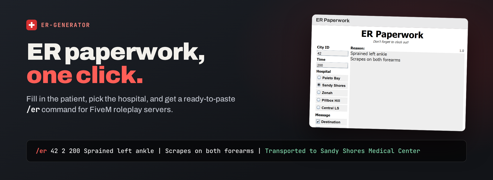
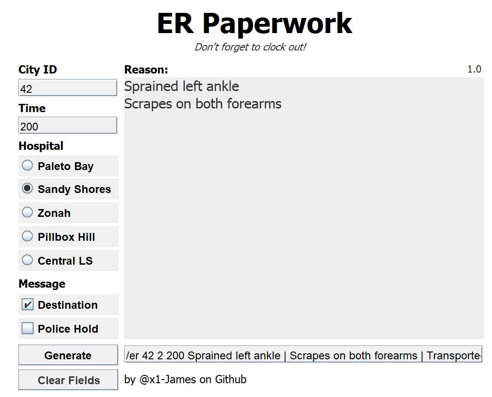

# ER-Generator



<p align="center">
  <a href="https://github.com/jameskbb/ER-Generator/releases/latest"></a>
  <a href="LICENSE"></a>
  <a href="#run-it"></a>
  <a href="#run-it"></a>
</p>

**A small desktop form that writes the `/er` hospital command for FiveM
roleplay servers, so a medic can finish the paperwork without breaking the
scene.**

The patient is stable, the scene is still running, and the server wants one
long, strictly ordered line: the patient's ID, a hospital number, a time, and a
pipe-separated list of injuries. Typing that by hand is slow and easy to get
wrong. ER-Generator turns it into a form: fill in the patient, pick the
hospital, press **Generate**, and the finished command is already on your
clipboard. To get it, grab the jar from the
[latest release](https://github.com/jameskbb/ER-Generator/releases/latest)
(details in [Run it](#run-it)).



## From form to command

The form above produces:

```text
/er 42 2 200 Sprained left ankle | Scrapes on both forearms | Transported to Sandy Shores Medical Center
```

| Field | Becomes |
|---|---|
| **City ID** | The patient's in-game ID, first argument |
| **Hospital** | A number: Paleto Bay `1`, Sandy Shores `2`, Zonah `3`, Pillbox Hill `4`, Central LS `5` |
| **Time** | The hospital time, `200` by default |
| **Reason** | One injury per line, joined with ` \| ` |
| **Destination** | Appends `Transported to <hospital> Medical Center`, using the full name (Mount Zonah, Central Los Santos); on by default |
| **Police Hold** | Sets the time to `1800` and appends `[Police Hold <City ID>]`; unticking restores the previous time |

**Generate** writes the command to the output field, selects it and copies it
to the clipboard. **Clear Fields** empties the reason and output, unticks
Police Hold, and resets the hospital to Pillbox Hill and the time to the
default; the City ID stays.

### Your server numbers hospitals differently?

The hospital numbers and the command layout match the server ER-Generator was
written for. If your server numbers its hospitals differently, change the
mapping in [`MainWindow.java`](src/me/x1james/ergenerator/MainWindow.java) and
rebuild.

## Run it

You need Java 8 or newer.

1. Download `ER.Generator.v1.0.jar` from the
   [latest release](https://github.com/jameskbb/ER-Generator/releases/latest).
2. Double-click it, or run:

   ```sh
   java -jar ER.Generator.v1.0.jar
   ```

### Build from source

The whole app is one Swing class with no dependencies:

```sh
javac -d out src/me/x1james/ergenerator/MainWindow.java
java -cp out me.x1james.ergenerator.MainWindow
```

The repository is also an Eclipse project (`.project`, `.classpath`), so it
imports directly.

## License

[MIT](LICENSE).
